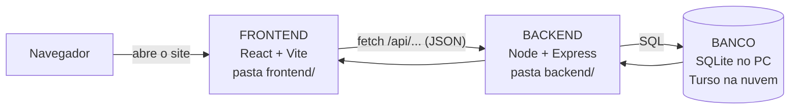
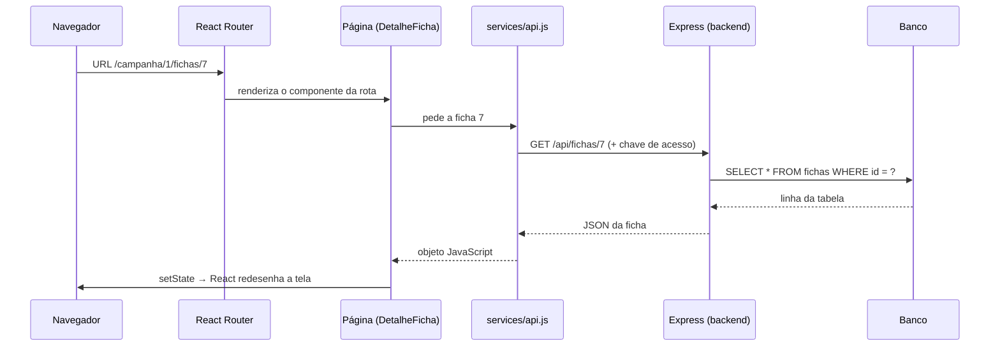
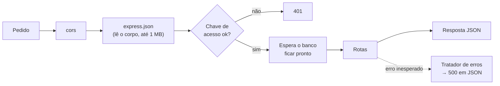

# Arquitetura do HubRPG

Guia para entender como o HubRPG é construído, escrito para quem está começando.
Leia na ordem na primeira vez; depois, use o índice como consulta.

> **Mantenha este arquivo vivo.** Mudou algo que está descrito aqui (uma pasta nova, uma regra
> de organização, uma ferramenta)? Atualize no mesmo PR.

## Índice

1. [Visão geral](#1-visão-geral)
2. [Stack tecnológica](#2-stack-tecnológica)
3. [Mapa de pastas](#3-mapa-de-pastas)
4. [O caminho de um dado: da tela ao banco](#4-o-caminho-de-um-dado-da-tela-ao-banco)
5. [Backend em detalhe](#5-backend-em-detalhe)
6. [Frontend em detalhe](#6-frontend-em-detalhe)
7. [Sistemas de RPG como pacotes](#7-sistemas-de-rpg-como-pacotes)
8. [Estilo e visual](#8-estilo-e-visual)
9. [Desempenho](#9-desempenho)
10. [Boas práticas usadas no projeto](#10-boas-práticas-usadas-no-projeto)
11. [Receitas: como fazer X](#11-receitas-como-fazer-x)
12. [Rodar, testar e publicar](#12-rodar-testar-e-publicar)
13. [Glossário](#13-glossário)
14. [Roteiro de leitura do código](#14-roteiro-de-leitura-do-código)

---

## 1. Visão geral

O HubRPG é um painel para o mestre de RPG: campanhas, fichas de personagens, NPCs, monstros e um
livro de regras para consulta. Ele é dividido em **duas aplicações independentes** que conversam
por HTTP:



- **Frontend:** tudo que roda no navegador. Desenha as telas e reage aos cliques.
- **Backend (API):** roda no servidor. Recebe pedidos, valida, lê e grava no banco.
- **Banco:** onde os dados ficam guardados de verdade.

Por que separar? Cada parte tem uma responsabilidade só. O frontend não sabe SQL; o backend não
sabe desenhar botões. Dá para trocar uma sem reescrever a outra.

---

## 2. Stack tecnológica

### Frontend

| Ferramenta | O que é | Para que usamos |
|---|---|---|
| **JavaScript + JSX** | A linguagem. JSX permite escrever "HTML" dentro do JS. | Todo o código das telas. |
| **React 19** | Biblioteca de interfaces baseada em **componentes**. | Montar a tela com peças reutilizáveis (`Seletor`, `Modal`…). |
| **React Router 7** | Roteador do lado do cliente. | Trocar de página sem recarregar (`/campanha/1/livro`). |
| **Vite 8** | Servidor de desenvolvimento e empacotador. | `npm run dev` (rápido, com recarga instantânea) e `npm run build` (gera os arquivos finais). |
| **Sass (SCSS)** | CSS com variáveis, aninhamento e mixins. | Todos os estilos. |
| **CSS Modules** | Arquivos `*.module.scss` com escopo local. | Cada componente tem seu CSS, sem conflito de nomes. |
| **oxlint** | Linter (analisa o código sem rodar). | Pegar erros e más práticas: `npm run lint`. |

### Backend

| Ferramenta | O que é | Para que usamos |
|---|---|---|
| **Node.js** | JavaScript fora do navegador. | Rodar o servidor. |
| **Express 5** | Framework web minimalista. | Definir as rotas da API e os middlewares. |
| **@libsql/client** | Cliente do libSQL (SQLite compatível). | Falar com o banco: arquivo local ou Turso. |
| **cors** | Middleware de CORS. | Permitir que o site (outro domínio) chame a API. |

### Infra e fluxo

| Ferramenta | Uso |
|---|---|
| **Git + GitHub** | Versionamento; uma branch por funcionalidade, PR para a `main`. |
| **Vercel** | Hospeda o frontend e o backend (como função serverless). |
| **Turso** | SQLite na nuvem, usado em produção. |

---

## 3. Mapa de pastas

```
HubRPG/
├── backend/
│   ├── src/
│   │   ├── server.js            ← monta o app Express: middlewares + rotas
│   │   ├── db.js                ← conexão com o banco, tabelas e migrações
│   │   └── routes/
│   │       ├── campanhas.js     ← /api/campanhas
│   │       ├── fichas.js        ← /api/fichas e /api/campanhas/:id/fichas
│   │       └── itensDaCampanha.js ← "fábrica" de rotas (sessões, personagens, notas)
│   ├── scripts/copiarParaNuvem.js ← copia dados do PC para o site no ar
│   └── data/hubrpg.sqlite       ← banco local (fora do Git)
│
├── frontend/
│   ├── index.html               ← página base: fontes, favicon, <div id="root">
│   ├── vite.config.js           ← plugin React + proxy /api → localhost:4000
│   └── src/
│       ├── main.jsx             ← ponto de entrada: liga o React ao HTML
│       ├── App.jsx              ← rotas de primeiro nível
│       ├── services/            ← conversa com o "mundo de fora"
│       │   ├── api.js           ← TODA chamada à API passa por aqui
│       │   └── imagem.js        ← reduzir fotos antes de enviar
│       ├── components/          ← peças genéricas reutilizáveis (Seletor, Modal…)
│       ├── pages/               ← telas (MenuCampanhas, Campanha e suas seções)
│       ├── sistemas/            ← um "pacote" por sistema de RPG
│       │   ├── index.js         ← registro dos sistemas
│       │   └── ordemParanormal/ ← dados, regras, ficha e livro de Ordem Paranormal
│       └── styles/              ← global.scss e _mixins.scss
│
└── docs/                        ← esta documentação
```

**Regra de ouro das pastas do frontend:**

| Pasta | Pode conter | Não deve conter |
|---|---|---|
| `components/` | Peças que servem a qualquer tela e qualquer sistema | Regra de Ordem Paranormal |
| `pages/` | Telas e o que é específico delas | Chamadas `fetch` diretas (use `services/api.js`) |
| `sistemas/<nome>/` | Tudo que é próprio de um sistema de RPG | Coisas genéricas do site |
| `services/` | Comunicação com API, navegador, arquivos | JSX / componentes |

---

## 4. O caminho de um dado: da tela ao banco

Exemplo: o usuário abre a ficha de um personagem.



Ao **editar** a ficha, o caminho é o mesmo ao contrário: a página chama a API com `PUT`, o
backend valida e grava, e devolve a ficha atualizada.

### O detalhe do proxy

No PC, o frontend roda em `localhost:5173` e o backend em `localhost:4000`. Em vez de o código
saber disso, o Vite tem um **proxy** ([frontend/vite.config.js](../frontend/vite.config.js)):

```js
server: { proxy: { '/api': 'http://localhost:4000' } }
```

O frontend sempre chama `/api/...`. No PC, o Vite repassa ao backend. Na Vercel, a variável
`VITE_API_URL` diz o endereço real. **O mesmo código funciona nos dois lugares.**

---

## 5. Backend em detalhe

### 5.1 Middlewares: a "esteira" de cada pedido

Em [backend/src/server.js](../backend/src/server.js), cada `app.use(...)` é uma etapa por onde o
pedido passa, **na ordem em que foi escrita**:



Um middleware é só uma função `(req, res, next)`: ela pode **responder** (e encerrar) ou chamar
`next()` para passar adiante. O último, com 4 parâmetros `(erro, req, res, next)`, é o
**tratador de erros**: qualquer exceção vira uma resposta 500 organizada em vez de derrubar o servidor.

### 5.2 Rotas

Cada arquivo em `routes/` cria um `Router` com as operações de um recurso (o famoso **CRUD**):

| Método HTTP | Significado | Exemplo |
|---|---|---|
| `GET` | ler | `GET /api/fichas/7` |
| `POST` | criar | `POST /api/campanhas/1/fichas` |
| `PUT` | atualizar | `PUT /api/fichas/7` |
| `DELETE` | apagar | `DELETE /api/fichas/7` |

E respondem com **códigos HTTP corretos**: `200` ok, `201` criado, `400` dado inválido,
`401` sem permissão, `404` não encontrado, `500` erro do servidor.

```js
router.get('/fichas/:id', async (req, res) => {
  const ficha = await buscarFicha(req.params.id);
  if (!ficha) return res.status(404).json({ erro: 'Ficha não encontrada' });
  res.json(ficha);
});
```

### 5.3 A fábrica de rotas

Sessões, personagens e notas têm o mesmo comportamento (listar, criar, editar, apagar dentro de
uma campanha). Em vez de copiar o código três vezes, existe uma **função que gera rotas**
([itensDaCampanha.js](../backend/src/routes/itensDaCampanha.js)):

```js
app.use('/api', criarRotasDeItens({
  tabela: 'notas',
  campos: { titulo: '', conteudo: '' },   // campos aceitos e valores padrão
  ordem: 'criado_em DESC',
}));
```

Isso é o princípio **DRY** (*Don't Repeat Yourself*): corrigir um bug ali corrige nos três recursos.

### 5.4 Banco de dados

[backend/src/db.js](../backend/src/db.js) esconde **onde** o banco está:

- Se existe `TURSO_DATABASE_URL` → usa o Turso (nuvem).
- Senão → usa o arquivo `backend/data/hubrpg.sqlite`.

O resto do backend só usa quatro atalhos: `db.get`, `db.all`, `db.run` e `db.lote` (transação).
Isso é **abstração**: quem usa não precisa saber os detalhes.

Três cuidados importantes:

1. **Parâmetros com `?`** — nunca colar valores no texto do SQL:
   ```js
   db.get('SELECT * FROM fichas WHERE id = ?', id);    // ✅ seguro
   db.get(`SELECT * FROM fichas WHERE id = ${id}`);    // ❌ SQL Injection
   ```
2. **Dados flexíveis em JSON** — a coluna `dados` da ficha guarda um texto JSON. Cada sistema de
   RPG tem uma ficha diferente; assim o banco não precisa de uma tabela por sistema.
3. **Migrações simples** — `adicionarColuna` só cria a coluna se ela ainda não existir. Bancos
   antigos se atualizam sozinhos ao iniciar, sem perder dados.

### 5.5 Segurança (por enquanto)

Ainda não há login. Em produção, a variável `CHAVE_ACESSO` exige o cabeçalho `x-chave-acesso`
em toda chamada. No PC, sem a variável, a API fica aberta para facilitar o desenvolvimento.

---

## 6. Frontend em detalhe

### 6.1 Componentes, props e estado

- **Componente**: uma função que devolve JSX. Ex.: `function Seletor(props) { return <div>…</div> }`.
- **Props**: os "parâmetros" que o pai passa ao filho (`<Livro campanha={campanha} />`).
  O filho **não altera** props.
- **Estado (`useState`)**: dados que mudam com o tempo e que, ao mudar, fazem o React redesenhar.

```jsx
const [busca, setBusca] = useState('');
<input value={busca} onChange={(e) => setBusca(e.target.value)} />
```

Isso é um **input controlado**: o valor mora no estado do React, não no HTML.

### 6.2 Rotas

[App.jsx](../frontend/src/App.jsx) tem as rotas de topo (`/` e `/campanha/:id/*`).
A página da campanha ([Campanha.jsx](../frontend/src/pages/Campanha/Campanha.jsx)) tem rotas
**aninhadas**: `jogadores`, `npcs`, `monstros`, `fichas/:fichaId`, `livro`…
Assim o menu lateral fica fixo e só o conteúdo troca.

### 6.3 Falando com a API

**Toda** chamada passa por [services/api.js](../frontend/src/services/api.js). Vantagens:

- Um lugar só para o endereço base, cabeçalhos e tratamento de erro.
- A chave de acesso é lida/salva ali. Se a API responder `401`, o usuário é perguntado **uma vez
  só**, mesmo que várias chamadas falhem juntas (todas esperam a mesma `Promise`).
- `localStorage` é acessado dentro de `try/catch`: em aba anônima ele pode falhar e o site segue.

### 6.4 Onde guardar cada estado

| Tipo de estado | Onde guardar | Exemplo no projeto |
|---|---|---|
| Só daquele componente, temporário | `useState` | texto da busca do livro |
| Deve sobreviver ao F5 / ser compartilhável | **URL** (`useSearchParams`) | seção e filtros do livro (`?secao=rituais&elemento=san`) |
| Dados do servidor | API → `useState` na página | a ficha aberta |
| Preferência do navegador | `localStorage` | chave de acesso, painéis recolhidos |

### 6.5 Calcule, não sincronize

Se um valor pode ser **calculado** a partir de outro, calcule durante a renderização em vez de
criar mais um `useState` + `useEffect` para mantê-lo igual:

```jsx
// ✅ calculado a cada render
const visiveis = algumFiltro ? aplicarFiltros(atual.entradas, escolhas) : atual.entradas;

// ❌ estado duplicado que precisa ser "sincronizado"
const [visiveis, setVisiveis] = useState([]);
useEffect(() => setVisiveis(aplicarFiltros(...)), [escolhas]);
```

Menos estado = menos bugs de "a tela ficou desatualizada". Quando o cálculo é pesado e atrapalha a
digitação, use `useDeferredValue` (como na busca do livro).

### 6.6 Efeitos que se cancelam

Ao buscar dados num `useEffect`, a resposta pode chegar depois que o usuário já saiu da tela.
O padrão do projeto evita atualizar um componente que não existe mais:

```jsx
useEffect(() => {
  const efeito = { ativo: true };
  sistema.livro().then((s) => efeito.ativo && setSecoes(s));
  return () => { efeito.ativo = false; };   // limpeza: roda ao sair
}, [sistema]);
```

---

## 7. Sistemas de RPG como pacotes

Este é o coração da arquitetura. O site é **genérico**; o que é de cada RPG fica num **pacote**.

[sistemas/index.js](../frontend/src/sistemas/index.js) é um registro:

```js
const SISTEMAS = { [ordemParanormal.id]: ordemParanormal };
export const obterSistema = (id) => SISTEMAS[id] ?? null;
```

Cada pacote exporta um objeto com um **formato combinado (contrato)**:

| Campo | Para que serve |
|---|---|
| `id`, `nome` | Identificação |
| `paleta` | Variáveis de cor do tema da campanha |
| `Ficha` | Componente da ficha (carregado sob demanda) |
| `fichaInicial` | Valores de uma ficha nova |
| `classes`, `origens`, `trilhas(classe)` | Listas para telas genéricas (ex.: modal de nova ficha) |
| `livro()` | Seções do livro de regras (carregado sob demanda) |
| funções de `regras.js` | Cálculos (defesa, carga, proficiências…) |

As telas genéricas **nunca perguntam** "é Ordem Paranormal?". Elas usam o contrato:

```jsx
const sistema = obterSistema(campanha.sistema_id);
if (!sistema?.livro) return <p>Este sistema ainda não tem livro.</p>;
```

Para adicionar um sistema novo, cria-se outra pasta e registra-se no `index.js` — sem mexer nas
telas. Isso é o **princípio aberto/fechado**: aberto para extensão, fechado para modificação.

### Dentro de um pacote: dados × regras × tela

```
ordemParanormal/
├── modelo.js     ← DADOS: atributos, perícias, classes, origens, elementos, proteções
├── rituais.js    ← DADOS: lista de rituais
├── itens.js      ← DADOS: armas e equipamentos
├── trilhas.js    ← DADOS: trilhas e habilidades por NEX
├── regras.js     ← REGRAS: funções puras de cálculo
├── inventario.js ← regras/ajudantes do inventário
├── compendio.js  ← textos do livro (resumos com página)
├── livro.js      ← monta as seções do livro a partir de tudo acima
├── index.js      ← o "pacote" (contrato)
└── FichaOrdemParanormal/ ← TELA: componentes da ficha
```

**Funções puras** (em `regras.js`) recebem valores e devolvem um resultado, sem tocar em tela,
banco ou estado global. São fáceis de entender, reutilizar e testar.

**Fonte única de verdade:** o livro não copia os rituais — ele os **gera** a partir de
`rituais.js`, o mesmo arquivo que a ficha usa. Corrigiu um ritual? Corrigiu nos dois lugares.

---

## 8. Estilo e visual

### Camadas de CSS

1. **[styles/global.scss](../frontend/src/styles/global.scss)** — reset, fontes, cores base, regras
   que valem para o site inteiro.
2. **[styles/_mixins.scss](../frontend/src/styles/_mixins.scss)** — trechos reutilizáveis:
   ```scss
   @use '../../styles/mixins' as *;
   .area { @include celular { grid-template-columns: 1fr; } }   // só em telas pequenas
   ```
3. **`Componente.module.scss`** — o estilo de cada componente. A classe `.titulo` vira algo como
   `Livro_titulo_x7a2`, então nunca colide com outro `.titulo`.

### Temas com variáveis CSS

As cores são **variáveis** (`--cor`, `--fundo`, `--superficie`, `--borda`, `--texto`,
`--texto-suave`). Cada sistema define as suas em `paleta`; a campanha aplica e o site inteiro
muda de tema sem tocar nos componentes. Componentes **usam** as variáveis, nunca cores fixas:

```scss
.chip { border: 1px solid var(--borda); color: var(--texto-suave); }
```

Variáveis também podem vir do JSX — é assim que cada cartão de elemento ganha a sua cor:

```jsx
<article style={{ '--el': elemento.cor }} className={styles.elemento}>
```

### Identidade visual

- Fontes: **Barlow Condensed** (títulos) e **IBM Plex Sans** (texto). **Nunca fontes serifadas.**
- Visual "dossiê": grafite fosco, ocre de pasta de arquivo, vermelho de carimbo.
- Mobile primeiro: toda tela é testada em ~365px de largura sem rolagem horizontal.

---

## 9. Desempenho

### Code splitting (dividir o código)

Por padrão, o Vite juntaria todo o app num arquivo só. Com `import()` dinâmico, ele corta em
pedaços que só são baixados quando necessários:

```jsx
const Campanha = lazy(() => import('./pages/Campanha/Campanha'));     // página
const Livro    = lazy(() => import('./secoes/Livro/Livro'));          // seção
livro: () => import('./livro').then((m) => m.secoesDoLivro()),        // dados
```

- `lazy` + `<Suspense>`: o React mostra o `fallback` enquanto o pedaço chega.
- Resultado: a tela inicial não carrega a ficha, o grimório nem o livro.
- Confira o tamanho de cada pedaço na saída do `npm run build`.

### Outros cuidados

- Fotos são **reduzidas no navegador** ([services/imagem.js](../frontend/src/services/imagem.js))
  antes de ir para a API (~30 KB em vez de vários MB).
- Fundo decorativo feito com CSS (sem imagens pesadas).
- Fontes carregadas com `preconnect` e só os pesos usados.

---

## 10. Boas práticas usadas no projeto

| Prática | Onde ver | Por que importa |
|---|---|---|
| Separação de responsabilidades | frontend × backend; dados × regras × tela | Cada parte muda sem quebrar as outras |
| Contrato / plugin | `sistemas/` | Novos sistemas sem mexer nas telas |
| Fonte única de verdade | livro gerado a partir dos dados da ficha | Nada fica desatualizado |
| DRY | `criarRotasDeItens` | Um bug corrigido uma vez só |
| Abstração | `db.js`, `services/api.js` | Detalhes escondidos num lugar só |
| Funções puras | `regras.js` | Fáceis de entender e testar |
| Estado mínimo | cálculos na renderização | Menos bugs de sincronia |
| Estado na URL | livro (`useSearchParams`) | Voltar, F5 e links funcionam |
| SQL parametrizado | rotas do backend | Proteção contra SQL Injection |
| Códigos HTTP corretos | rotas do backend | Erros claros para o frontend |
| Tratador de erros central | fim do `server.js` | O servidor não cai com uma exceção |
| Falhar com elegância | `try/catch` no `localStorage` | O site funciona em aba anônima |
| HTML semântico + ARIA | `<nav>`, `<details>`, `aria-pressed` | Acessível e com comportamento grátis |
| Componentes próprios acessíveis | `Seletor` (teclado completo) | Visual próprio sem perder usabilidade |
| Comentários de "porquê" | todo o código | Explicam a intenção, não o óbvio |
| Branch por funcionalidade + PR | histórico do Git | Mudanças revisáveis e reversíveis |
| Conventional Commits | `feat:`, `fix:`, `perf:` | Histórico legível |

---

## 11. Receitas: como fazer X

### Adicionar uma rota na API

1. Escolha o arquivo em `backend/src/routes/` (ou crie um novo `Router`).
2. Valide a entrada e responda com o código HTTP certo.
3. Use `?` nos parâmetros do SQL.
4. Se criou um arquivo novo, registre em `server.js` com `app.use('/api', ...)`.
5. Adicione a função correspondente em `frontend/src/services/api.js`.

### Adicionar uma coluna no banco

Em `db.js`, dentro de `iniciar()`, chame `adicionarColuna('tabela', 'coluna', 'TEXT DEFAULT ...')`.
Ela é segura para rodar várias vezes.

### Criar um componente reutilizável

1. Pasta `frontend/src/components/NomeDoComponente/` com `NomeDoComponente.jsx` e
   `NomeDoComponente.module.scss`.
2. Receba tudo por props; não dependa de um sistema de RPG específico.
3. Use as variáveis de cor (`var(--cor)` etc.) e teste no celular.

### Criar uma nova seção da campanha

1. Pasta em `frontend/src/pages/Campanha/secoes/NovaSecao/`.
2. Registre a rota em `Campanha.jsx` (com `lazy` + `Suspense` se for pesada).
3. Adicione o item no `MenuCampanha.jsx` (tire o `emBreve`, se houver).

### Adicionar conteúdo ao livro de Ordem Paranormal

- **Regra escrita:** em `compendio.js`, use `e(nome, pagina, texto, tabela?)`. Escreva **com as
  nossas palavras** e indique a página do livro.
- **Seção gerada a partir de dados:** crie uma função `secaoX()` em `livro.js` e inclua em
  `secoesDoLivro()`.
- **Filtro:** dê à seção `filtros: [{ id, rotulo, opcoes }]` e a cada entrada `tags: { id: [valores] }`.
  Para ajustar a entrada ao filtro (cortar linhas), use `aplicar(escolhas)`.

### Adicionar um novo sistema de RPG

1. Crie `frontend/src/sistemas/novoSistema/index.js` exportando o objeto do contrato
   (seção 7) — comece com `id`, `nome`, `paleta`, `Ficha` e `fichaInicial`.
2. Registre em `sistemas/index.js`.
3. Campos opcionais (`livro`, `trilhas`…) podem vir depois: as telas checam se existem.

---

## 12. Rodar, testar e publicar

### Rodar no PC

```bash
cd backend && npm install && npm run dev     # API em http://localhost:4000
```

```bash
cd frontend && npm install && npm run dev    # site em http://localhost:5173
```

### Antes de abrir um PR

```bash
cd frontend && npm run lint && npm run build
```

- `lint` precisa passar sem erros novos.
- `build` precisa terminar; confira se nenhum pedaço cresceu sem motivo.
- Teste a tela no navegador, inclusive em largura de celular.

### Fluxo de Git

1. `git checkout -b feat/nome-da-funcionalidade` a partir da `main` atualizada.
2. Commits pequenos com mensagens no padrão `tipo(escopo): descrição`.
3. `git push -u origin feat/nome-da-funcionalidade` e abra o PR para a `main`.

### Variáveis de ambiente (produção)

| Variável | Onde | Para quê |
|---|---|---|
| `VITE_API_URL` | frontend | Endereço da API |
| `TURSO_DATABASE_URL`, `TURSO_AUTH_TOKEN` | backend | Banco na nuvem |
| `CHAVE_ACESSO` | backend | Proteção até existir login |
| `ORIGEM_SITE` | backend | Domínio liberado no CORS |

Para levar dados do PC para o site no ar: `node scripts/copiarParaNuvem.js <url-da-api> <chave>`
(dentro de `backend/`). Pode rodar de novo sem duplicar.

---

## 13. Glossário

| Termo | Significado |
|---|---|
| **API** | Conjunto de endereços que um programa oferece para outro usar. |
| **REST / CRUD** | Convenção de usar métodos HTTP (`GET`, `POST`, `PUT`, `DELETE`) para ler, criar, atualizar e apagar. |
| **JSON** | Formato de texto para trocar dados: `{ "nome": "Arthur" }`. |
| **Middleware** | Função que processa o pedido antes (ou depois) da rota. |
| **CORS** | Regra do navegador que bloqueia chamadas entre domínios diferentes, a menos que o servidor libere. |
| **Proxy** | Intermediário que repassa pedidos para outro endereço. |
| **Componente** | Função do React que devolve um pedaço de tela. |
| **Props** | Dados que o componente pai passa para o filho. |
| **Estado (state)** | Dados que mudam e fazem a tela redesenhar. |
| **Hook** | Funções `use…` do React (`useState`, `useEffect`, `useSearchParams`…). |
| **SPA** | *Single Page Application*: o site carrega uma vez e troca de tela sem recarregar. |
| **Code splitting** | Dividir o código em pedaços baixados sob demanda. |
| **Lazy loading** | Carregar algo só quando for necessário. |
| **CSS Modules** | CSS com nomes de classe únicos por arquivo. |
| **Mixin (Sass)** | Bloco de CSS reutilizável incluído com `@include`. |
| **Função pura** | Mesma entrada → mesma saída, sem efeitos colaterais. |
| **Migração** | Mudança na estrutura do banco aplicada de forma controlada. |
| **SQL Injection** | Ataque que insere comandos SQL por meio de dados não tratados. |
| **Serverless** | O código roda sob demanda numa plataforma (Vercel) em vez de um servidor sempre ligado. |
| **Linter** | Ferramenta que analisa o código e aponta problemas sem executá-lo. |

---

## 14. Roteiro de leitura do código

Leia nesta ordem; cada passo usa o anterior.

1. [backend/src/server.js](../backend/src/server.js) — como a API é montada.
2. [backend/src/db.js](../backend/src/db.js) — banco, tabelas e migrações.
3. [backend/src/routes/fichas.js](../backend/src/routes/fichas.js) — um CRUD completo.
4. [backend/src/routes/itensDaCampanha.js](../backend/src/routes/itensDaCampanha.js) — a fábrica de rotas.
5. [frontend/src/main.jsx](../frontend/src/main.jsx) e [App.jsx](../frontend/src/App.jsx) — onde o React começa.
6. [frontend/src/services/api.js](../frontend/src/services/api.js) — a ponte com o backend.
7. [frontend/src/sistemas/index.js](../frontend/src/sistemas/index.js) →
   [ordemParanormal/index.js](../frontend/src/sistemas/ordemParanormal/index.js) — o contrato dos sistemas.
8. [frontend/src/sistemas/ordemParanormal/regras.js](../frontend/src/sistemas/ordemParanormal/regras.js) — funções puras.
9. [frontend/src/components/Seletor/Seletor.jsx](../frontend/src/components/Seletor/Seletor.jsx) — um componente reutilizável e acessível.
10. [frontend/src/pages/Campanha/secoes/Livro/Livro.jsx](../frontend/src/pages/Campanha/secoes/Livro/Livro.jsx) —
    uma tela completa: carga sob demanda, busca, filtros e estado na URL.
